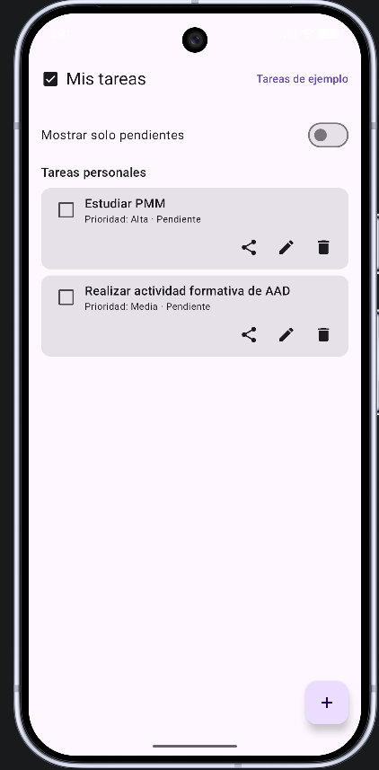
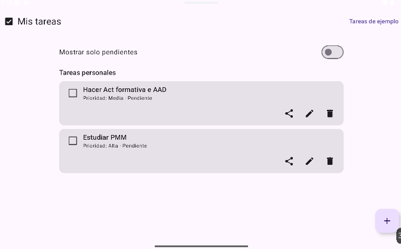
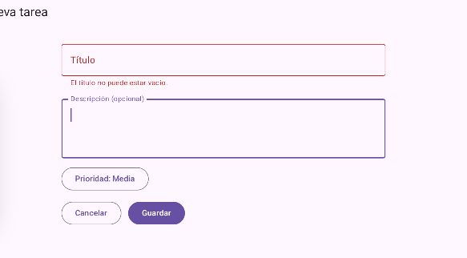
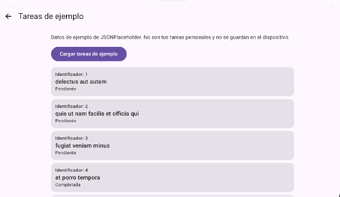
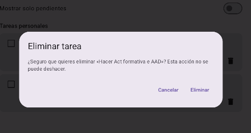

# Gestor Personal de Tareas

Aplicación Android (Kotlin + Jetpack Compose + Material 3) para gestionar tareas personales, académicas o profesionales. Práctica del módulo **PMDM – Programación Multimedia y Dispositivos Móviles**.

> **Estado de la entrega:** el código está completo, pero las pruebas en emulador, las capturas, el APK y el enlace al chat de IA **los debes completar tú** (secciones marcadas con ⚠️). No marques como «correcto» ninguna prueba que no hayas ejecutado.

## Funcionalidades implementadas

- Listado de tareas con `LazyColumn` (título, prioridad y estado) y mensaje informativo cuando no hay tareas.
- Crear y editar tareas con formulario: título, descripción y prioridad (menú desplegable), con validación y mensajes junto al campo.
  - Título obligatorio, mínimo 3 caracteres tras `trim()`; prioridad entre Baja/Media/Alta; descripción opcional.
  - El botón Guardar se deshabilita mientras se escribe en la base de datos, por lo que no se crean duplicados.
- Marcar como completada (`Checkbox`) y eliminar con confirmación (`AlertDialog`). Todo se escribe en Room.
- Persistencia con **Room** (entidad, DAO, base de datos); la lista se observa con `Flow`.
- Filtro «Mostrar solo pendientes» (`Switch`) guardado con **Preferences DataStore** (valor inicial: mostrar todas).
- «Tareas de ejemplo»: `GET /todos?userId=1` de JSONPlaceholder con **Retrofit + Gson**, indicador de carga, botón deshabilitado durante la petición, mensaje de error y botón Reintentar. Pantalla y datos separados de las tareas personales (no se guardan en Room).
- Compartir una tarea con `ACTION_SEND` (`text/plain`) y selector del sistema. Si no hay app compatible se avisa; nunca se afirma que se haya enviado.
- Navegación simple basada en estado (única `MainActivity`), icono vectorial local y diseño adaptable (contenido con ancho máximo centrado en pantallas grandes).
- Único permiso: `INTERNET`.

## Organización del proyecto

```
app/src/main/java/es/centro/gestortareas/
├── MainActivity.kt
├── model/        Tarea, Prioridad, ValidacionTarea
├── data/
│   ├── local/        TareaEntity, TareaDao, AppDatabase   (Room)
│   ├── preferences/  Ajustes.kt                            (DataStore)
│   └── remote/       TareaRemota, ApiTareas, ServicioTareas (Retrofit)
├── ui/           GestorTareasApp (navegación), ListaTareasScreen,
│                 FormularioTareaScreen, TareasEjemploScreen,
│                 TareasViewModel, EjemploViewModel, theme/
└── util/         Compartir.kt (Intent ACTION_SEND)
```

## Bibliotecas utilizadas

Jetpack Compose (BOM 2025.01.00) y Material 3 · Room 2.8.4 (+KSP) · DataStore Preferences 1.1.1 · Retrofit 3.0.0 + converter-gson (OkHttp transitivo) · Kotlin Coroutines 1.9.0 · Lifecycle ViewModel/Runtime Compose 2.8.7 · Activity Compose 1.9.3. Versiones centralizadas en `gradle/libs.versions.toml`.

Entorno previsto: AGP 8.7.3, Kotlin 2.1.0, KSP 2.1.0-1.0.29, Gradle 8.9, JDK 17, compileSdk/targetSdk 35, minSdk 24. Si Android Studio te sugiere versiones más recientes compatibles entre sí, puedes actualizarlas (KSP debe coincidir con la versión de Kotlin).

## Cómo ejecutar

1. Abre la carpeta `GestorTareas` con Android Studio y espera a la sincronización de Gradle (si falta el wrapper, Android Studio lo descargará según `gradle-wrapper.properties`).
2. Crea o inicia un emulador (Device Manager) y pulsa **Run ▶** con la configuración `app`.
3. Para generar el APK de depuración: `./gradlew assembleDebug` (Windows: `gradlew.bat assembleDebug`). Resultado en `app/build/outputs/apk/debug/app-debug.apk`. Copia ese archivo a la raíz del repositorio para entregarlo.

## Emuladores utilizados

| | Emulador 1  | Emulador 2  |
| :--- | :--- | :--- |
| **Perfil** | Pixel 10 Pro | Small Tablet |
| **Resolución / densidad** | 1280 × 2856 / 480 dpi | 1600 × 2560 / 320 dpi *(o 800 × 1280 / mdpi según perfil)* |
| **API / imagen** | API 37.0 (Android 17.0 "CinnamonBun" \| x86_64) | API 37.0 (Android 17.0 "CinnamonBun" \| x86_64) |

## Capturas de pantalla

| Emulador 1 (Pixel 10 Pro) | Emulador 2 (Small Tablet) |
| :---: | :---: |
|  |  |

## Pruebas realizadas

| Nº | Prueba | Resultado esperado | Resultado obtenido (Emu. 1 / Emu. 2) | Estado |
| :---: | :--- | :--- | :--- | :---: |
| 1 | Crear una tarea válida | Se guarda y aparece en la lista | Se guarda correctamente y se muestra al instante en la lista (Emu. 1 / Emu. 2) | OK |
| 2 | Guardar con título vacío | Error visible y no se crea | Muestra aviso de error en el campo y bloquea la creación (Emu. 1 / Emu. 2) | OK |
| 3 | Editar una tarea | Los cambios se muestran | Actualiza los datos y refleja los cambios en el listado (Emu. 1 / Emu. 2) | OK |
| 4 | Marcar como completada | Cambia de estado y se conserva | Marca la tarea como completada y mantiene su estado (Emu. 1 / Emu. 2) | OK |
| 5 | Cancelar una eliminación | La tarea no desaparece | Cierra el diálogo y mantiene la tarea intacta en la lista (Emu. 1 / Emu. 2) | OK |
| 6 | Eliminar confirmando | Desaparece de la base de datos | Elimina la tarea de la lista y de la base de datos local (Emu. 1 / Emu. 2) | OK |
| 7 | Cerrar y reabrir la app | Se recuperan las tareas | Al volver a abrir la app se cargan todas las tareas guardadas (Emu. 1 / Emu. 2) | OK |
| 8 | Activar el filtro y reiniciar | Se conserva la preferencia | Mantiene el estado del filtro seleccionado tras reiniciar la app (Emu. 1 / Emu. 2) | OK |
| 9 | Consultar la API con Internet | Se muestran las tareas | Descarga y lista correctamente las tareas remotas de la API (Emu. 1 / Emu. 2) | OK |
| 10 | Consultar la API sin conexión | Error y botón Reintentar | Muestra mensaje de error de red y permite reintentar (Emu. 1 / Emu. 2) | OK |
| 11 | Compartir una tarea | Se abre el selector de apps | Despliega la hoja de compartir del sistema con los datos de la tarea (Emu. 1 / Emu. 2) | OK |
| 12 | Cambiar la orientación | La app sigue funcionando y conserva datos | Adapta la interfaz a horizontal/vertical sin perder el estado ni los datos (Emu. 1 / Emu. 2) | OK |

## Capturas de pantalla

| Pantalla / Funcionalidad | Captura |
| :--- | :---: |
| **Listado principal (Pixel 10 Pro - Compacto)** |  |
| **Listado principal (Small Tablet - Grande)** |  |
| **Formulario de creación (error de validación)** |  |
| **Consulta a la API (JSONPlaceholder)** |  |
| **Interacción relevante (diálogo de borrado)** |  |

## ⚠️ Chat de IA utilizado

Enlace: _pega aquí el enlace al chat_

## Incidencias conocidas / limitaciones

- Proyecto generado sin poder compilarlo ni ejecutarlo en un emulador: pueden aparecer ajustes menores de versiones al sincronizar Gradle por primera vez.
- Al girar la pantalla, el diálogo de borrado se conserva (se guarda el id), pero un guardado en curso se completa en segundo plano gracias al `ViewModel`.
- Añade aquí cualquier otra incidencia que observes durante las pruebas.
